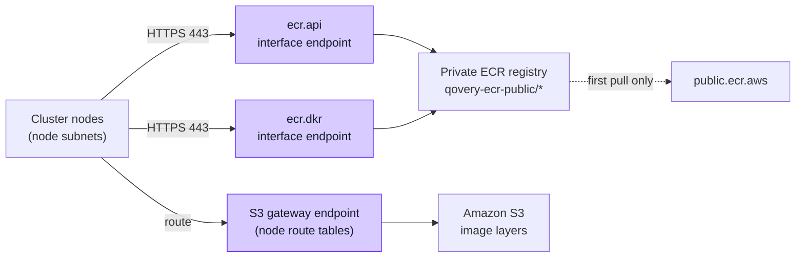

The [`aws.ecr.enable_pull_through_cache`](/configuration/cluster-advanced-settings#aws-ecr-enable-pull-through-cache) advanced setting caches the public ECR images of Qovery-managed infrastructure components in the private ECR registry of your AWS account. Its goal is to cut the NAT Gateway charges generated when nodes pull these images.

On a VPC managed by Qovery, Qovery creates the VPC endpoints that keep these pulls inside the VPC. When the cluster runs on your existing VPC, you own the network, so you create these endpoints yourself. This tutorial walks through the setup with the AWS CLI.

## How it works

Nodes reach the private ECR registry through two interface endpoints, and download image layers from Amazon S3 through a gateway endpoint. On the first pull of an image, Amazon ECR imports it from `public.ecr.aws` itself, without going through your NAT Gateway.



You need:

| Endpoint | Type | Requirement |
|---|---|---|
| `com.amazonaws.<region>.ecr.api` | Interface | Private DNS enabled, security groups accept TCP 443 from the node subnets |
| `com.amazonaws.<region>.ecr.dkr` | Interface | Private DNS enabled, security groups accept TCP 443 from the node subnets |
| `com.amazonaws.<region>.s3` | Gateway | Attached to the route table of every node subnet |

Without the S3 gateway endpoint, image layers, which make up most of the traffic, still go through the NAT Gateway.

<Info>
The S3 gateway endpoint has no charge. Interface endpoints are billed per hour and per availability zone, plus a charge per GB processed that is lower than the NAT Gateway one. See [AWS PrivateLink pricing](https://aws.amazon.com/privatelink/pricing/).
</Info>

## Prerequisites

- A Qovery-managed EKS cluster deployed on your existing VPC, with Karpenter enabled
- AWS CLI v2 with credentials allowed to manage VPC endpoints, security groups and VPC attributes in the cluster's AWS account
- The VPC ID and the subnet IDs you entered when creating the cluster

The **node subnets** are the EKS subnets of the cluster, plus its private subnets when nodes are created in private subnets. The endpoints must be in the cluster VPC itself: Qovery does not look for endpoints shared from another VPC.

## Step 1: Set the variables

The commands of this tutorial work in bash and zsh. Replace the values with yours:

```bash
export AWS_REGION=eu-west-3
VPC_ID=vpc-0123456789abcdef0

# Every node subnet: the EKS subnets, plus the private subnets if nodes are created in private subnets
NODE_SUBNETS=(subnet-0aaaaaaaaaaaaaaaa subnet-0bbbbbbbbbbbbbbbb subnet-0cccccccccccccccc)

# One subnet per availability zone where nodes run, to host the interface endpoints
ENDPOINT_SUBNETS=(subnet-0aaaaaaaaaaaaaaaa subnet-0bbbbbbbbbbbbbbbb subnet-0cccccccccccccccc)
```

An interface endpoint accepts only one subnet per availability zone. The node subnets themselves can host it.

## Step 2: Check the existing endpoints

```bash
aws ec2 describe-vpc-endpoints \
  --filters "Name=vpc-id,Values=$VPC_ID" \
    "Name=service-name,Values=com.amazonaws.$AWS_REGION.ecr.api,com.amazonaws.$AWS_REGION.ecr.dkr,com.amazonaws.$AWS_REGION.s3" \
  --query 'VpcEndpoints[].[ServiceName,VpcEndpointType,State,PrivateDnsEnabled,VpcEndpointId]' \
  --output table
```

If an endpoint already exists for a service, do not create a second one: the steps below explain how to update it.

## Step 3: Enable DNS in the VPC

Private DNS on interface endpoints requires both DNS attributes of the VPC. The command changes one attribute at a time:

```bash
aws ec2 modify-vpc-attribute --vpc-id "$VPC_ID" --enable-dns-support '{"Value":true}'
aws ec2 modify-vpc-attribute --vpc-id "$VPC_ID" --enable-dns-hostnames '{"Value":true}'
```

## Step 4: Create the security group of the ECR endpoints

Create a security group that accepts TCP 443 from every CIDR block of the VPC, which covers all node subnets. The commands reuse the group if it already exists, so you can run them again:

```bash
ENDPOINT_SG_ID=$(aws ec2 describe-security-groups \
  --filters "Name=vpc-id,Values=$VPC_ID" "Name=group-name,Values=ecr-vpc-endpoints" \
  --query 'SecurityGroups[0].GroupId' --output text)

if [ "$ENDPOINT_SG_ID" = "None" ]; then
  ENDPOINT_SG_ID=$(aws ec2 create-security-group \
    --vpc-id "$VPC_ID" \
    --group-name ecr-vpc-endpoints \
    --description "HTTPS to the ECR VPC endpoints" \
    --query GroupId --output text)
fi
echo "Endpoint security group: $ENDPOINT_SG_ID"

for cidr in $(aws ec2 describe-vpcs --vpc-ids "$VPC_ID" \
  --query 'Vpcs[0].CidrBlockAssociationSet[?CidrBlockState.State==`associated`].CidrBlock' \
  --output text); do
  aws ec2 authorize-security-group-ingress \
    --group-id "$ENDPOINT_SG_ID" --protocol tcp --port 443 --cidr "$cidr"
done
```

Check that the `echo` prints a security group ID (`sg-...`) before going further: the next steps use it. When you run the commands again, `authorize-security-group-ingress` reports `InvalidPermission.Duplicate` for the rules that already exist. You can ignore it.

Qovery accepts any of these sources on the endpoint security groups:

- A CIDR that contains each node subnet, such as the VPC CIDR or the subnet CIDRs
- The EKS cluster security group, which exists only after the first cluster deployment
- A prefix list. Qovery does not resolve it and trusts that it covers the node subnets

<Warning>
Create this security group before enabling private DNS on the endpoints. With private DNS, every ECR request made from the VPC goes through the endpoint, including the pulls of your own applications. If the endpoint security group blocks TCP 443, every ECR pull in the VPC fails.
</Warning>

## Step 5: Create the ECR interface endpoints

```bash
for service in ecr.api ecr.dkr; do
  aws ec2 create-vpc-endpoint \
    --vpc-id "$VPC_ID" \
    --vpc-endpoint-type Interface \
    --service-name "com.amazonaws.$AWS_REGION.$service" \
    --subnet-ids "${ENDPOINT_SUBNETS[@]}" \
    --security-group-ids "$ENDPOINT_SG_ID" \
    --private-dns-enabled
done
```

If an ECR endpoint already exists, update it instead of creating a second one. Run the following for each existing ECR endpoint. First, add the security group and enable private DNS:

```bash
ENDPOINT_ID=vpce-0123456789abcdef0

aws ec2 modify-vpc-endpoint --vpc-endpoint-id "$ENDPOINT_ID" \
  --add-security-group-ids "$ENDPOINT_SG_ID" \
  --private-dns-enabled
```

Then check that the endpoint has a subnet in every availability zone where nodes run. Compare the zones it covers with the zones of your endpoint subnets:

```bash
# Zones the endpoint covers
aws ec2 describe-subnets \
  --subnet-ids $(aws ec2 describe-vpc-endpoints --vpc-endpoint-ids "$ENDPOINT_ID" \
    --query 'VpcEndpoints[0].SubnetIds' --output text) \
  --query 'Subnets[].AvailabilityZone' --output text

# Zones of the endpoint subnets set in step 1
aws ec2 describe-subnets --subnet-ids "${ENDPOINT_SUBNETS[@]}" \
  --query 'Subnets[].[AvailabilityZone,SubnetId]' --output text
```

For each zone missing from the endpoint, add the matching subnet. An endpoint accepts only one subnet per zone, so do not add subnets for the zones it already covers:

```bash
aws ec2 modify-vpc-endpoint --vpc-endpoint-id "$ENDPOINT_ID" \
  --add-subnet-ids subnet-0cccccccccccccccc
```

Nodes in a zone without an endpoint subnet still reach the endpoint through another zone, so Qovery does not report it. That traffic adds cross-zone data transfer charges and depends on the other zone being available.

The endpoints become `available` after a few minutes. Run the command of step 2 to follow their state.

## Step 6: Find the route tables of the node subnets

A subnet without an explicit route table association uses the main route table of the VPC:

```bash
MAIN_ROUTE_TABLE=$(aws ec2 describe-route-tables \
  --filters "Name=vpc-id,Values=$VPC_ID" "Name=association.main,Values=true" \
  --query 'RouteTables[0].RouteTableId' --output text)

NODE_ROUTE_TABLES=()
for subnet in "${NODE_SUBNETS[@]}"; do
  route_table=$(aws ec2 describe-route-tables \
    --filters "Name=association.subnet-id,Values=$subnet" \
    --query 'RouteTables[0].RouteTableId' --output text)
  [ "$route_table" = "None" ] && route_table=$MAIN_ROUTE_TABLE
  echo "$subnet uses $route_table"
  NODE_ROUTE_TABLES+=("$route_table")
done
NODE_ROUTE_TABLES=($(printf '%s\n' "${NODE_ROUTE_TABLES[@]}" | sort -u))
```

## Step 7: Attach an S3 gateway endpoint to these route tables

```bash
aws ec2 create-vpc-endpoint \
  --vpc-id "$VPC_ID" \
  --vpc-endpoint-type Gateway \
  --service-name "com.amazonaws.$AWS_REGION.s3" \
  --route-table-ids "${NODE_ROUTE_TABLES[@]}"
```

If an S3 gateway endpoint already exists, attach the route tables to it instead:

```bash
aws ec2 modify-vpc-endpoint --vpc-endpoint-id vpce-0123456789abcdef0 \
  --add-route-table-ids "${NODE_ROUTE_TABLES[@]}"
```

## Step 8: Review what Qovery does not check

Qovery checks the endpoints, their private DNS, their security groups and the route tables. It does not check the following, which can still block image pulls:

- **Endpoint policies**: keep the default policy, which allows full access. A restricted policy on the ECR endpoints must allow pulling images and, for the cache, `ecr:BatchImportUpstreamImage` and `ecr:CreateRepository` on `arn:aws:ecr:<region>:<account-id>:repository/qovery-ecr-public/*`. A restricted policy on the S3 endpoint must allow `s3:GetObject` on `arn:aws:s3:::prod-<region>-starport-layer-bucket/*`, the bucket that serves ECR image layers. See [Amazon ECR interface VPC endpoints](https://docs.aws.amazon.com/AmazonECR/latest/userguide/vpc-endpoints.html).
- **Network ACLs**: custom network ACLs on the node and endpoint subnets must allow TCP 443 from the nodes to the endpoint subnets and to Amazon S3, and the return traffic on ephemeral ports (1024-65535).

## Step 9: Enable the setting and deploy the cluster

Set [`aws.ecr.enable_pull_through_cache`](/configuration/cluster-advanced-settings#aws-ecr-enable-pull-through-cache) to `true` in the advanced settings of the cluster, then deploy the cluster.

During the deployment, Qovery checks the endpoints. When everything is in place, the cluster logs show:

```
The custom VPC provides the endpoints required by the ECR pull through cache.
```

If something is missing, the deployment goes through every step and then ends in error, listing what is missing. Qovery components still use the cache, but their traffic goes through the NAT Gateway until you fix the VPC and deploy the cluster again.

## Troubleshooting

The deployment error lists one entry per missing prerequisite:

| Entry in the error | Fix |
|---|---|
| An available `ecr.api` or `ecr.dkr` interface endpoint | Create it (step 5). If you just created it, wait until it is `available` |
| Private DNS enabled on the interface endpoint | Run `modify-vpc-endpoint --private-dns-enabled` on it (step 5) |
| Inbound TCP 443 on the security groups of the interface endpoint, from node subnets | Allow TCP 443 from the listed subnets on one of the endpoint security groups (step 4) |
| An available `s3` gateway endpoint | Create it (step 7) |
| Route table of node subnets attached to the `s3` gateway endpoint | Attach the listed route table (step 7) |
| A route table for node subnet | The subnet has no route table and the VPC has no main route table: associate one with the subnet |

If the error says that Qovery cannot check the custom VPC, the AWS credentials of the cluster are missing one of these permissions: `ec2:DescribeVpcEndpoints`, `ec2:DescribeSubnets`, `ec2:DescribeRouteTables`, `ec2:DescribeSecurityGroups`.
