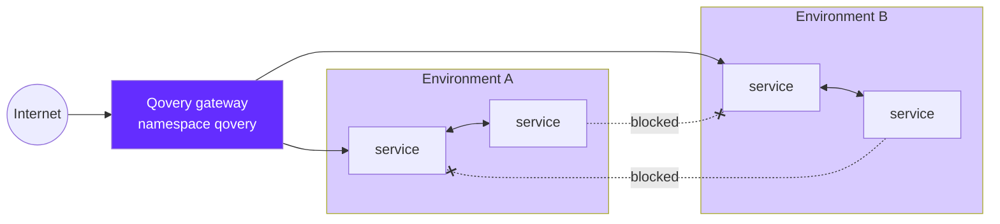

Each Qovery environment runs in its own Kubernetes namespace, but by default Kubernetes lets every pod reach every other pod in the cluster, whatever the namespace. When several environments share a cluster, one per customer in a multi-tenant setup for example, a service in one environment can call the internal endpoints of another.

This guide shows how to isolate environments from each other with a Kubernetes `NetworkPolicy`, deployed as a Helm service in each environment. You don't need any cluster-wide permission, and the policy follows the environment: it is cloned with it and deleted with it.

## How it works

The policy is a plain Kubernetes object, deployed with the generic [`raw`](https://github.com/bedag/helm-charts/tree/master/charts/raw) Helm chart. It allows incoming traffic only from:

- pods in the same namespace (the same environment)
- the Qovery system namespaces, so public traffic coming through the cluster gateway still reaches your services

Everything else is dropped, including traffic from other environments.



## Prerequisites

- An environment running on a cluster that enforces NetworkPolicies. Qovery-managed clusters do this out of the box.
- On a self-managed cluster, enforcement depends on your CNI. Cilium and Calico enforce NetworkPolicies; some CNIs, such as Flannel used alone, accept the objects but ignore them. Check your CNI before relying on this guide.

## Step 1: Add the Helm Repository

In the Qovery console, open **Organization settings → Helm Repositories → Add repository** and enter:

- Kind: **HTTPS**
- Repository URL: `https://bedag.github.io/helm-charts`

You only do this once per organization. See [Helm Repository](/configuration/organization/helm-repository) for details.

## Step 2: Create the Policy Service

In the environment you want to isolate, create a **Helm** service:

- Name: `tenant-isolation`
- Helm source: **Helm repository**, the repository from Step 1
- Chart name: `raw`
- Version: `2.0.2`. Pin the version.
- **Allow cluster-wide resources**: disabled. A NetworkPolicy lives in the environment namespace.

In **Values override file**, choose **Raw YAML** and paste:

```yaml
resources:
  - apiVersion: networking.k8s.io/v1
    kind: NetworkPolicy
    metadata:
      name: tenant-isolation
    spec:
      podSelector: {}
      policyTypes: [Ingress]
      ingress:
        # services of the same environment
        - from:
            - podSelector: {}
        # Qovery system namespaces
        - from:
            - namespaceSelector:
                matchExpressions:
                  - key: kubernetes.io/metadata.name
                    operator: In
                    values: [qovery, kube-system, prometheus, nginx-ingress, logging]
```

`podSelector: {}` selects every pod of the namespace, so the policy applies to all services of the environment, including the ones you add later.

The allowed system namespaces:

| Namespace | Why |
| :---- | :---- |
| `qovery` | Runs the cluster gateway. Without it, the public URLs of the environment stop responding. |
| `kube-system` | Cluster components. |
| `prometheus` | Metrics collection, when Qovery observability is enabled on the cluster. |
| `nginx-ingress` | Clusters still exposing services through NGINX. |
| `logging` | Log collection. |

<Warning>
If the console asks for a name for the values file, don't use `values.yaml`: it replaces the chart's own defaults. Use `override.yaml`.
</Warning>

## Step 3: Deploy the Policy Before Your Services

Move the `tenant-isolation` service to a [deployment stage](/configuration/deployment/pipeline) that runs before your applications, for example a new first stage. Your services are then never running without the policy, including in new environments.

Deploy the environment.

<Warning>
On AWS EKS, a new NetworkPolicy only applies to new connections. Connections that were already open, such as the keep-alive connections held by the gateway, keep working until they close. When you add the policy to an environment that is already running, redeploy its services after the policy is deployed.
</Warning>

## Step 4: Apply It to Every Environment

Isolation only holds if every environment has the policy. An environment without it accepts traffic from all the others.

- Add the service to the environment you clone to create new environments, so every clone gets it.
- For [Preview Environments](/configuration/environment#preview-environments), add it to the blueprint environment.
- Repeat Steps 2 and 3 in existing environments.

## Step 5: Check the Isolation

Open a [shell](/cli/commands/shell) on a service of environment A, then call a service of the same environment and a service of environment B by their internal hostname:

```bash
# internal hostname: <host>.<namespace>.svc.cluster.local
# <host> is the QOVERY_<TYPE>_Z<ID>_HOST_INTERNAL variable of the target service
# <namespace> is the QOVERY_KUBERNETES_NAMESPACE_NAME variable of its environment
# <port> is the internal port of the target service
curl -s -m 3 -o /dev/null -w '%{http_code}\n' http://<host-a>.<namespace-a>.svc.cluster.local:<port-a>
curl -s -m 3 -o /dev/null -w '%{http_code}\n' http://<host-b>.<namespace-b>.svc.cluster.local:<port-b>
```

The first call returns a status code; the second one times out (`000`). Public URLs of both environments keep responding.

The shell runs in your service's container, so the image needs `curl` (or `wget`).

## Optional: Restrict Outgoing Traffic

The policy above controls incoming traffic. Each environment blocks the others, so this is enough to isolate environments from each other. To also stop the services of an environment from opening connections to other environments, add an egress section. Egress rules depend on the cluster network, so the values differ by cloud provider.

<Tabs>
  <Tab title="AWS EKS">
    ```yaml
    resources:
      - apiVersion: networking.k8s.io/v1
        kind: NetworkPolicy
        metadata:
          name: tenant-isolation
        spec:
          podSelector: {}
          policyTypes: [Ingress, Egress]
          ingress:
            - from:
                - podSelector: {}
            - from:
                - namespaceSelector:
                    matchExpressions:
                      - key: kubernetes.io/metadata.name
                        operator: In
                        values: [qovery, kube-system, prometheus, nginx-ingress, logging]
          egress:
            # services of the same environment
            - to:
                - podSelector: {}
            # DNS
            - to:
                - namespaceSelector:
                    matchLabels:
                      kubernetes.io/metadata.name: kube-system
              ports:
                - { protocol: UDP, port: 53 }
                - { protocol: TCP, port: 53 }
            # internet, but not the cluster network
            - to:
                - ipBlock:
                    cidr: 0.0.0.0/0
                    except:
                      - 10.0.0.0/16      # your cluster VPC CIDR
                      - 172.20.0.0/16    # EKS Service CIDR when the VPC is in 10.0.0.0/8
                      - 10.100.0.0/16    # EKS Service CIDR otherwise
    ```

    On EKS, egress rules are evaluated against the Service IP, not the IP of the pod behind it. Excluding the VPC CIDR alone lets traffic to other environments' Services through: keep the Service CIDRs in `except`.

    Qovery doesn't set a custom Service CIDR, so EKS uses one of the two defaults above. To check yours, look at the cluster IP of the `kubernetes` Service in the `default` namespace (`kubectl get svc kubernetes -n default`): it belongs to the Service CIDR.

    Qovery creates the cluster VPC with `10.0.0.0/16` unless you set a **Custom VPC Subnet** on the cluster. If you did, or if the cluster uses an existing VPC, replace `10.0.0.0/16` with the VPC CIDR shown in the AWS console.
  </Tab>
  <Tab title="Other managed clusters">
    ```yaml
    resources:
      - apiVersion: networking.k8s.io/v1
        kind: NetworkPolicy
        metadata:
          name: tenant-isolation
        spec:
          podSelector: {}
          policyTypes: [Ingress, Egress]
          ingress:
            - from:
                - podSelector: {}
            - from:
                - namespaceSelector:
                    matchExpressions:
                      - key: kubernetes.io/metadata.name
                        operator: In
                        values: [qovery, kube-system, prometheus, nginx-ingress, logging]
          egress:
            # services of the same environment
            - to:
                - podSelector: {}
            # DNS
            - to:
                - namespaceSelector:
                    matchLabels:
                      kubernetes.io/metadata.name: kube-system
              ports:
                - { protocol: UDP, port: 53 }
                - { protocol: TCP, port: 53 }
            # internet, but not the other pods of the cluster
            - to:
                - ipBlock:
                    cidr: 0.0.0.0/0
                    except:
                      - 100.64.0.0/15    # your cluster pod CIDR (Scaleway Kapsule default)
    ```

    Replace `100.64.0.0/15` with the pod CIDR of your cluster.
  </Tab>
</Tabs>

<Warning>
With an egress policy, everything not listed is blocked. Managed databases and other cloud resources inside the cluster network (RDS, ElastiCache, managed PostgreSQL, ...) become unreachable: add an `ipBlock` rule to their subnet. Keep the DNS rule, or name resolution fails for every service of the environment.
</Warning>

## Remove the Isolation

Delete the `tenant-isolation` Helm service, then redeploy the environment.

Don't empty the `resources` list instead: a chart that renders no object makes the deployment fail.

## Troubleshooting

<AccordionGroup>
  <Accordion title="The public URL of a service times out after deploying the policy">
    The `qovery` namespace is missing from the allowed namespaces. The cluster gateway runs there.
  </Accordion>
  <Accordion title="A service of another environment is still reachable">
    - On AWS EKS, connections opened before the policy keep working: redeploy the services of the protected environment.
    - Check that the protected environment has the `tenant-isolation` service deployed. The policy protects the environment it is deployed in, not the environment the traffic comes from.
    - On a self-managed cluster, check that your CNI enforces NetworkPolicies.
  </Accordion>
  <Accordion title="The deployment fails with 'cluster-wide resource should be allowed'">
    The `resources` list is empty or a manifest has no `metadata`. To remove the policy, delete the Helm service instead.
  </Accordion>
  <Accordion title="Services can't resolve hostnames after adding an egress section">
    The DNS rule to `kube-system` on port 53 is missing.
  </Accordion>
  <Accordion title="Services can't reach their database after adding an egress section">
    The database sits inside the cluster network, which the `except` list blocks. Add an `ipBlock` rule to the database subnet.
  </Accordion>
</AccordionGroup>

## Related

- [Filter Outbound Traffic with an Egress Proxy](/getting-started/guides/advanced-tutorials/egress-filtering-squid-proxy): restrict the domains a service can call.
- [Helm](/configuration/helm): Helm service configuration.
- [Deployment pipeline](/configuration/deployment/pipeline): deployment stages.
